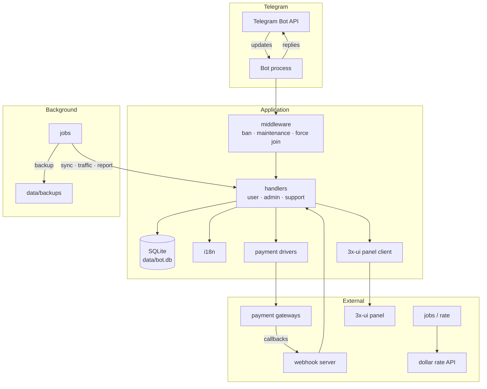
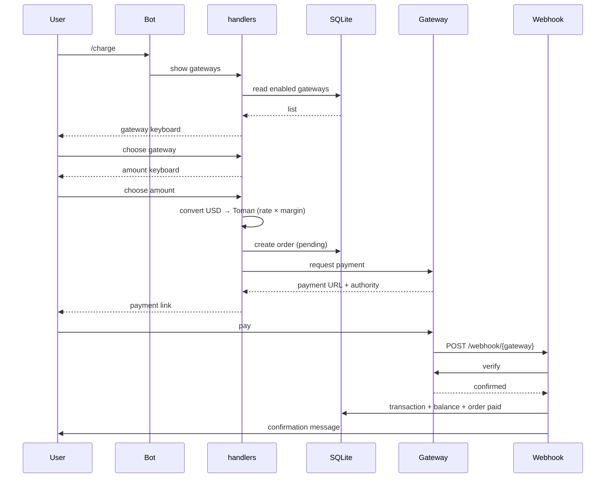
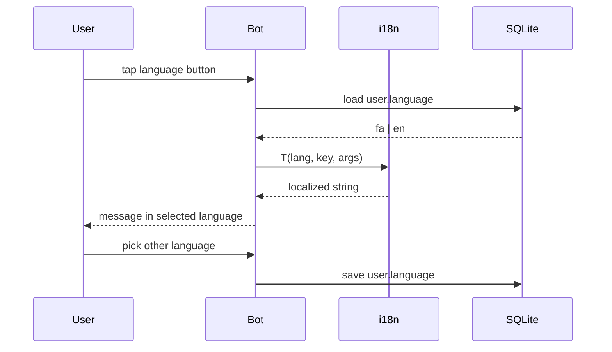
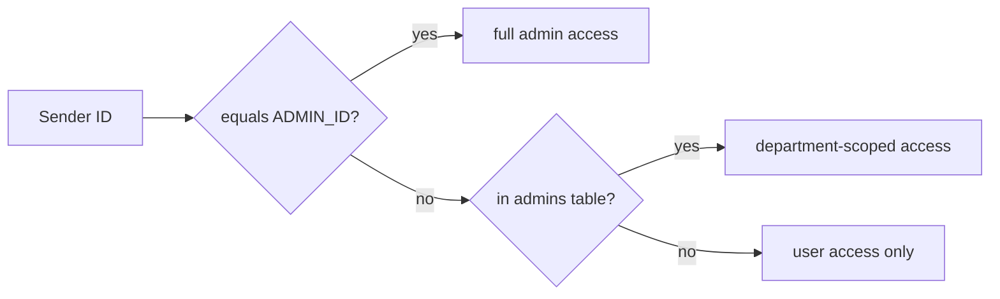
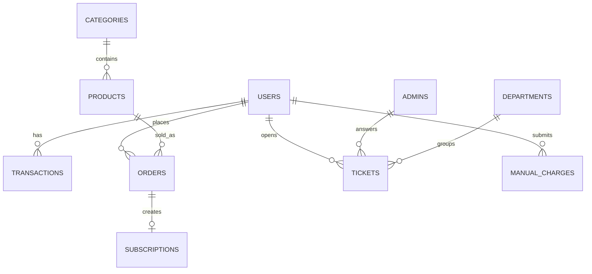

# Architecture

## 📊 System overview

## 📦 Package responsibilities

| Package | Responsibility | Depends on |
| :--- | :--- | :--- |
| `internal/bot` | Assemble the bot, start polling, webhook server and jobs | config, handlers, database, jobs |
| `internal/config` | Load and validate `.env` | godotenv |
| `internal/database` | Persistence facade and SQLite implementation | sqlite driver |
| `internal/handlers` | Translate updates into domain actions | database, i18n, payment, xui |
| `internal/i18n` | Message lookup for `fa` and `en` | — |
| `internal/menus` | Keyboard construction | i18n |
| `internal/middleware` | Pre-handler gates | database, config |
| `internal/payment` | Gateway drivers behind one interface | config |
| `internal/rate` | Dollar rate with cache and margin | config |
| `internal/jobs` | Scheduled work | database, notify |
| `internal/webhook` | HTTP callback receiver | handlers, payment |
| `internal/xui` | 3x-ui API client | config |
| `internal/notify` | Outbound notifications and audit log | database |

### Layering rule

`handlers` and `jobs` may depend on `database`, `payment`, `rate`, `i18n` and `xui`.
`database`, `payment`, `rate` and `i18n` must never import `handlers`.
`config` imports nothing from `internal` except `isenv`.

---

## 💳 Charge flow

Key guarantees:

- The order is persisted **before** the payment link is shown, so a lost reply never loses money.
- Balance updates run inside a transaction together with the `transactions` insert.
- Webhook processing is idempotent: a repeated callback for an already-paid order is acknowledged without double crediting.

---

## 🌐 Language flow

- Translations live in one map in `internal/i18n/i18n.go` keyed by message ID.
- Every handler renders through `T(lang, key, args...)`; no Persian or English literal is inlined in handlers.
- `LangLabel()` provides the human-readable language name for menus.

---

## 🔐 Security

### Access control

- Admin identity is verified on every admin callback, not only when the panel opens.
- A department-scoped admin only sees tickets belonging to their departments.
- Banned users are dropped in middleware before any handler runs.

### Input validation

- Amounts validated against `CHARGE_MIN`/`CHARGE_MAX`.
- Receipt photos validated for type and size before storing.
- User-supplied text escaped before HTML-format replies.
- Gateway selections validated against enabled gateways.

### Secrets

`BOT_TOKEN`, gateway keys and webhook secrets live only in `.env`. They are never written to the database, logged, or echoed in chat.

---

## 🗄️ Data model

- WAL mode keeps readers non-blocking while the backup job snapshots the file.
- Migrations are applied in `migrate.go` on every start and are safe to re-run.

---

## ⚙️ Background jobs

| Job | Interval | Purpose |
| :--- | :--- | :--- |
| `backup` | scheduled | Copy `bot.db` into `data/backups/` |
| `sync` | scheduled | Refresh panel state and subscription data |
| `traffic` | periodic | Read usage and warn users near limits |
| `daily_report` | daily | Push the day's statistics to the main admin |

Each job runs in its own goroutine, recovers from panics, logs failures and never blocks update handling.

---

## 📈 Extending the bot

1. **New user command** — add a handler in `internal/handlers/` and register it in `handlers.go`.
2. **New admin screen** — add a file under `internal/handlers/admin/` and a button in `panel.go`.
3. **New strings** — add the key to both `fa` and `en` maps in `i18n.go`.
4. **New table** — extend `schema.sql`, add queries in `internal/database/sqlite/`, wire them in `migrate.go`.
5. **New gateway** — implement the `payment.gateway.go` interface and add a webhook branch.
6. **New language** — add a `Lang` constant, a translation map, and expose it in the language menu.

---

## 🧪 Testing strategy

- **Unit** — pure helpers: rate conversion, i18n lookup, validation.
- **Integration** — handler flows against a temporary SQLite file.
- **Webhook** — sign a payload with the test secret and assert idempotency.
- **Manual** — full charge flow against a gateway sandbox.

---

## 🔗 More

[Usage guide](./usage.md) · [API reference](./API.md) · [Setup](./setup.md) · [Structure](../../STRUCTURE.md) · [Persian version](../fa/architecture.md)
