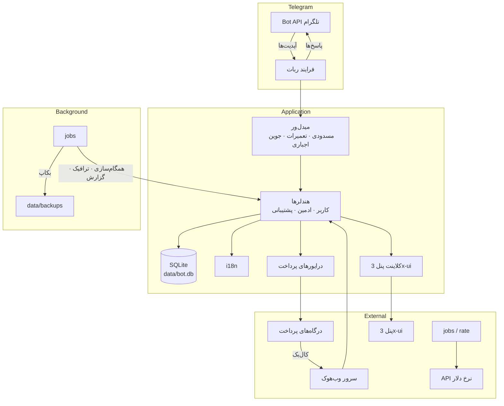
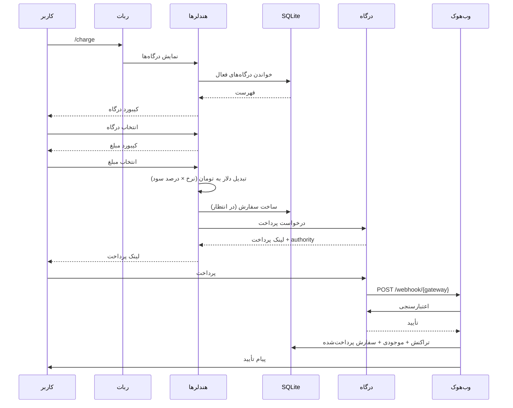
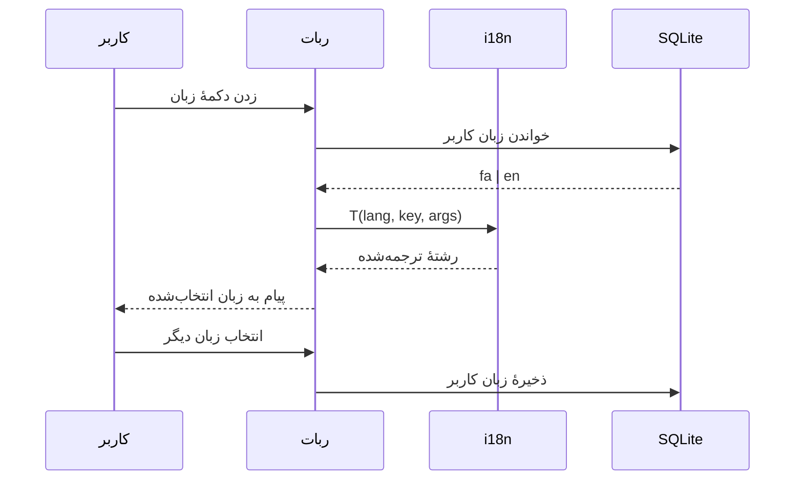
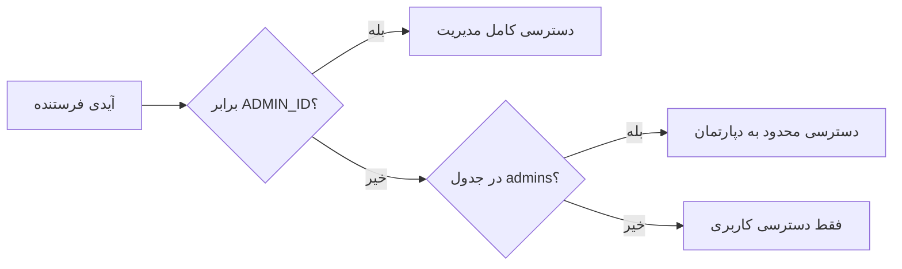
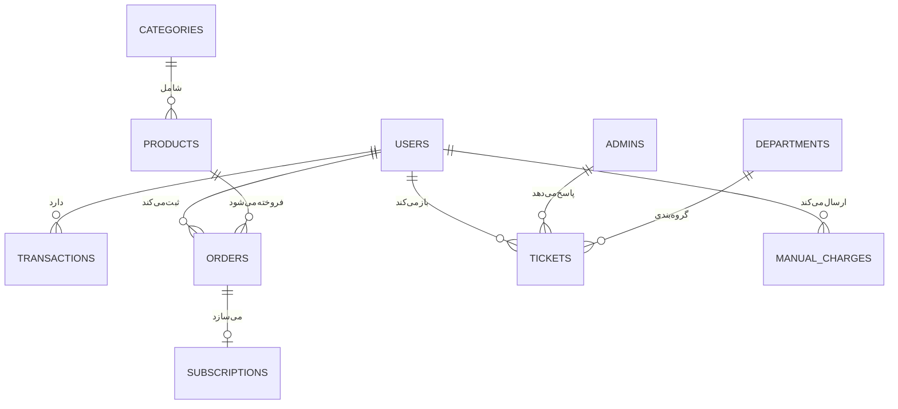

# معماری

## 📊 نمای کلی سیستم

## 📦 مسئولیت پکیج‌ها

| پکیج | مسئولیت | وابستگی |
| :--- | :--- | :--- |
| `internal/bot` | ساخت ربات، شروع polling، سرور وب‌هوک و کارها | config، handlers، database، jobs |
| `internal/config` | خواندن و اعتبارسنجی `.env` | godotenv |
| `internal/database` | واسط ذخیره‌سازی و پیاده‌سازی SQLite | درایور sqlite |
| `internal/handlers` | تبدیل آپدیت‌ها به عملیات دامنه | database، i18n، payment، xui |
| `internal/i18n` | جستجوی پیام برای `fa` و `en` | — |
| `internal/menus` | ساخت کیبوردها | i18n |
| `internal/middleware` | دروازه‌های پیش از هندلر | database، config |
| `internal/payment` | درایورهای درگاه پشت یک واسط | config |
| `internal/rate` | نرخ دلار با کش و درصد سود | config |
| `internal/jobs` | کارهای زمان‌بندی‌شده | database، notify |
| `internal/webhook` | دریافت HTTP کال‌بک | handlers، payment |
| `internal/xui` | کلاینت API پنل 3x-ui | config |
| `internal/notify` | اطلاع‌رسانی خروجی و لاگ حسابرسی | database |

### قاعدهٔ لایه‌بندی

`handlers` و `jobs` می‌توانند به `database`، `payment`، `rate`، `i18n` و `xui` وابسته باشند.
`database`، `payment`، `rate` و `i18n` هرگز نباید `handlers` را ایمپورت کنند.
`config` به‌جز `isenv` چیزی از `internal` ایمپورت نمی‌کند.

---

## 💳 جریان شارژ

تضمین‌های کلیدی:

- سفارش **قبل از** نمایش لینک پرداخت ذخیره می‌شود تا از دست رفتن پاسخ باعث از بین رفتن پول نشود.
- به‌روزرسانی موجودی همراه با درج در `transactions` در یک تراکنش انجام می‌شود.
- پردازش وب‌هوک تکرارپذیر (idempotent) است: کال‌بک تکراری برای سفارش پرداخت‌شده بدون افزایش دوبارهٔ موجودی تأیید می‌شود.

---

## 🌐 جریان زبان

- ترجمه‌ها در یک نقشه در `internal/i18n/i18n.go` با کلید شناسهٔ پیام قرار دارند.
- هر هندلر از `T(lang, key, args...)` استفاده می‌کند؛ هیچ متن فارسی یا انگلیسی‌ای مستقیم در هندلرها نوشته نمی‌شود.
- `LangLabel()` نام قابل‌نمایش زبان را برای منوها فراهم می‌کند.

---

## 🔐 امنیت

### کنترل دسترسی

- هویت ادمین در هر کال‌بک مدیریتی بررسی می‌شود، نه فقط هنگام باز کردن پنل.
- ادمین محدود به دپارتمان تنها تیکت‌های همان دپارتمان‌ها را می‌بیند.
- کاربران مسدود در میدل‌ور پیش از هر هندلری حذف می‌شوند.

### اعتبارسنجی ورودی

- مبالغ با `CHARGE_MIN` و `CHARGE_MAX` بررسی می‌شوند.
- تصویر رسید از نظر نوع و حجم پیش از ذخیره بررسی می‌شود.
- متن ورودی کاربر پیش از پاسخ HTML امن‌سازی می‌شود.
- انتخاب درگاه با درگاه‌های فعال اعتبارسنجی می‌شود.

### اسرار

`BOT_TOKEN`، کلیدهای درگاه و اسرار وب‌هوک فقط در `.env` قرار دارند. هرگز در دیتابیس نوشته نمی‌شوند، لاگ نمی‌شوند و در چت نمایش داده نمی‌شوند.

---

## 🗄️ مدل داده

- حالت WAL باعث می‌شود خواننده‌ها هنگام بکاپ‌گیری بلاک نشوند.
- مهاجرت‌ها در `migrate.go` در هر استارت اعمال می‌شوند و اجرای مجددشان بی‌خطر است.

---

## ⚙️ کارهای پس‌زمینه

| کار | بازه | هدف |
| :--- | :--- | :--- |
| `backup` | زمان‌بندی‌شده | کپی `bot.db` در `data/backups/` |
| `sync` | زمان‌بندی‌شده | به‌روزرسانی وضعیت پنل و داده‌های اشتراک |
| `traffic` | دوره‌ای | خواندن مصرف و هشدار به کاربران نزدیک سقف |
| `daily_report` | روزانه | ارسال آمار روز به مدیر اصلی |

هر کار در گوروتین خودش اجرا می‌شود، پس از panic بازیابی می‌شود، خطاها را لاگ می‌کند و هرگز پردازش آپدیت‌ها را بلاک نمی‌کند.

---

## 📈 توسعهٔ ربات

۱. **دستور جدید کاربر** — هندلر در `internal/handlers/` اضافه و در `handlers.go` ثبت کنید.
۲. **صفحهٔ جدید مدیریت** — فایل در `internal/handlers/admin/` و دکمه در `panel.go`.
۳. **رشتهٔ جدید** — کلید را در هر دو نقشهٔ `fa` و `en` در `i18n.go` اضافه کنید.
۴. **جدول جدید** — `schema.sql` را گسترش دهید، کوئری‌ها را در `internal/database/sqlite/` بنویسید و در `migrate.go` متصل کنید.
۵. **درگاه جدید** — واسط `payment/gateway.go` را پیاده‌سازی و شاخهٔ وب‌هوک را اضافه کنید.
۶. **زبان جدید** — ثابت `Lang`، نقشهٔ ترجمه و گزینهٔ منوی زبان را اضافه کنید.

---

## 🧪 راهبرد تست

- **واحد** — کمک‌تابع‌های خالص: تبدیل ارز، جستجوی i18n، اعتبارسنجی.
- **یکپارچه** — جریان هندلرها روی یک فایل SQLite موقت.
- **وب‌هوک** — بدنه را با کلید تست امضا کنید و تکرارپذیری را بررسی کنید.
- **دستی** — جریان کامل شارژ روی سندباکس درگاه.

---

## 🔗 بیشتر

[راهنمای استفاده](./usage.md) · [مرجع API](./API.md) · [نصب](./setup.md) · [ساختار](../../STRUCTURE.fa.md) · [نسخهٔ انگلیسی](../en/architecture.md)
