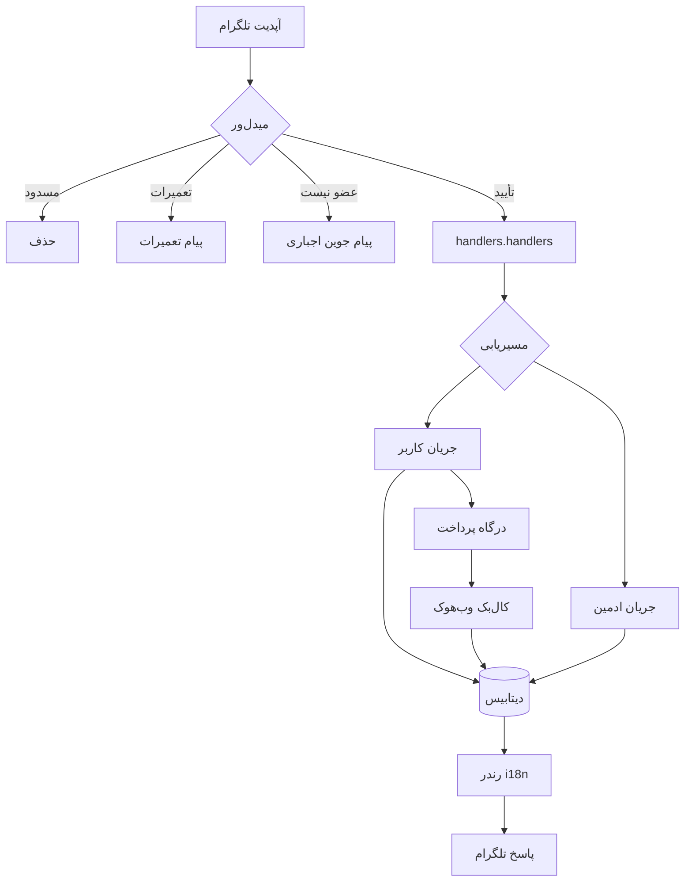

<div align="center">


# ساختار پروژهٔ GamajBot

[](./STRUCTURE.md)
[](./STRUCTURE.fa.md)

[](./README.md)
[](./README.fa.md)
[](./Docs/fa/architecture.md)
[](./Docs/fa/usage.md)
[](./Docs/fa/API.md)
[](./Docs/fa/setup.md)

</div>

---

## 📁 درخت پوشه‌ها

```text
GamajBot/
├── cmd/
│   └── AsliCode/
│       └── main.go                  # نقطهٔ ورود: خواندن تنظیمات، ساخت ربات، اجرا
├── internal/
│   ├── bot/                         # مونتاژ ربات، حلقهٔ polling، وب‌هوک، شروع کارها
│   │   └── bot.go
│   ├── config/                      # خواندن .env و ساخت تنظیمات نوع‌دار
│   │   └── config.go
│   ├── database/
│   │   ├── db.go                    # لایهٔ واسط دیتابیس
│   │   └── sqlite/                  # پیاده‌سازی SQLite
│   │       ├── db.go                # اتصال، استخر، pragmaها
│   │       ├── schema.sql           # اسکیمای کامل جدول‌ها
│   │       ├── migrate.go           # مهاجرت اسکیما
│   │       ├── users.go             # رکورد کاربران
│   │       ├── admin.go             # کوئری‌های ادمین
│   │       ├── admins.go            # مدیریت ادمین‌ها
│   │       ├── departments.go       # دپارتمان‌های پشتیبانی
│   │       ├── tickets.go           # تیکت‌های پشتیبانی
│   │       ├── transactions.go      # تراکنش‌های کیف پول
│   │       ├── manual_charge.go     # درخواست‌های شارژ دستی
│   │       ├── products.go          # محصولات و دسته‌بندی‌ها
│   │       ├── category_extra.go    # فیلدهای تکمیلی دسته‌بندی
│   │       ├── orders.go            # سفارش‌ها
│   │       ├── order_actions.go     # چرخهٔ عمر سفارش
│   │       ├── subscription.go      # اشتراک‌ها
│   │       ├── payment_gateways.go  # تنظیمات درگاه‌ها
│   │       ├── currency.go          # توابع ارز
│   │       ├── analytics.go         # آمار تجمیعی
│   │       ├── reports.go           # کوئری‌های گزارش
│   │       ├── settings.go          # تنظیمات کلید/مقدار
│   │       ├── log_topics.go        # تاپیک‌های لاگ ادمین
│   │       └── xui.go               # ذخیره‌سازی پنل 3x-ui
│   ├── handlers/                    # هندلرهای آپدیت تلگرام
│   │   ├── handlers.go              # ثبت و مسیریابی
│   │   ├── wallet.go                # موجودی، تاریخچه، شارژ
│   │   ├── wallet_manual_card.go    # جریان کارت‌به‌کارت دستی
│   │   ├── products.go              # مشاهده و خرید محصول
│   │   ├── services.go              # مدیریت سرویس
│   │   ├── subscription.go          # مشاهده و تمدید اشتراک
│   │   ├── language.go              # تغییر زبان
│   │   ├── forcejoin.go             # پیام جوین اجباری
│   │   ├── admin/                   # پنل مدیریت
│   │   │   ├── panel.go             # پنل اصلی و ناوبری
│   │   │   ├── users.go، admins.go  # مدیریت کاربر و ادمین
│   │   │   ├── ban.go، deduct.go    # مسدودسازی و کسر موجودی
│   │   │   ├── broadcast.go         # ارسال همگانی
│   │   │   ├── departments.go       # مدیریت دپارتمان
│   │   │   ├── tickets.go           # صندوق تیکت و پاسخ
│   │   │   ├── transactions.go      # مرور تراکنش‌ها
│   │   │   ├── finance.go           # نمای مالی
│   │   │   ├── manual_charge.go     # تأیید/رد رسید
│   │   │   ├── gateways.go          # فعال‌سازی و کلید درگاه‌ها
│   │   │   ├── product/category*    # ویرایشگر محصول و دسته
│   │   │   ├── orders.go، expiry.go # مدیریت سفارش و انقضا
│   │   │   ├── reports.go، stats.go، analytics.go
│   │   │   ├── settings.go          # تنظیمات زمان اجرا
│   │   │   ├── log_setup.go، log_actions.go
│   │   │   └── xui.go               # مدیریت پنل 3x-ui
│   │   ├── support/
│   │   │   └── tickets.go           # جریان تیکت از سمت کاربر
│   │   └── notify/
│   │       └── notify.go            # اطلاع‌رسانی به کاربر
│   ├── i18n/
│   │   └── i18n.go                  # نقشهٔ ترجمه‌های فارسی و انگلیسی
│   ├── isenv/
│   │   └── isenv.go                 # کمک‌تابع‌های محیط
│   ├── jobs/
│   │   ├── backup.go                # پشتیبان‌گیری زمان‌بندی‌شده
│   │   ├── sync.go                  # همگام‌سازی دوره‌ای
│   │   ├── traffic.go               # پایش ترافیک
│   │   └── daily_report.go          # گزارش روزانه
│   ├── menus/
│   │   └── menus.go                 # ساخت کیبوردها و منوها
│   ├── middleware/
│   │   ├── forcejoin.go             # دروازهٔ عضویت
│   │   ├── maintenance.go           # دروازهٔ حالت تعمیرات
│   │   └── ban.go                   # دروازهٔ کاربر مسدود
│   ├── notify/
│   │   ├── admin_actions.go         # فید اقدامات ادمین
│   │   └── admin_log.go             # لاگ حسابرسی ادمین
│   ├── payment/
│   │   ├── gateway.go               # واسط درگاه
│   │   ├── tetraminator.go          # اتصال تترامیناتور
│   │   ├── cubepay.go               # اتصال CubePay
│   │   ├── cubepay_manager.go       # مدیر نشست CubePay
│   │   └── abangateway.go           # اتصال AbanGateway
│   ├── qrcode/
│   │   └── qr.go                    # ساخت QR برای کانفیگ‌ها
│   ├── rate/
│   │   ├── dollar.go                # دریافت و کش نرخ دلار
│   │   └── currency.go              # توابع تبدیل ارز
│   ├── vpn/
│   │   └── panel.go                 # انتزاع پنل VPN
│   ├── xui/
│   │   ├── adapter.go               # آداپتر 3x-ui
│   │   ├── client.go                # کلاینت HTTP
│   │   ├── client_manage.go         # CRUD کلاینت
│   │   └── types.go                 # تایپ‌های API
│   ├── webhook/
│   │   └── server.go                # سرور HTTP کال‌بک درگاه‌ها
│   └── Services/
│       └── handler.go               # هندلرهای خدمات جانبی
├── data/                            # داده‌های زمان اجرا (خارج از گیت)
│   ├── bot.db                       # دیتابیس SQLite
│   ├── wallets.json                 # ذخیره‌گاه قدیمی کیف پول
│   └── backups/                     # بکاپ‌های خودکار دیتابیس
├── Docs/
│   ├── en/                          # راهنماهای انگلیسی
│   │   ├── usage.md
│   │   ├── API.md
│   │   ├── architecture.md
│   │   └── setup.md
│   └── fa/                          # راهنماهای فارسی
│       ├── usage.md
│       ├── API.md
│       ├── architecture.md
│       └── setup.md
├── scripts/
│   └── check-doc-links.sh           # بررسی‌کنندهٔ لینک مستندات (اجرا در CI)
├── .github/
│   └── workflows/
│       └── docs-links.yml           # CI: شکست در صورت لینک شکستهٔ مستندات
├── website/                         # سایت مستندات (تغییر زبان + جستجو)
│   ├── package.json
│   └── .vitepress/
│       ├── config.mts               # زبان‌ها، ناوبری، سایدبار، جستجوی آفلاین
│       └── theme/                   # تم پایه + پشتیبانی RTL برای فارسی
├── نه/                              # قرنطینه — خصوصی، ignore شده، هرگز منتشر نمی‌شود
│   ├── data/                        # دیتابیس SQLite، دادهٔ کیف پول و بکاپ‌های خودکار
│   └── .idea/                       # تنظیمات لوکال IDE
├── .env.example                     # قالب تنظیمات
├── .gitignore
├── go.mod / go.sum
├── LICENSE
├── README.md                        # ریدمی انگلیسی
├── README.fa.md                     # ریدمی فارسی
├── CHANGELOG.md / CHANGELOG.fa.md   # تاریخچهٔ انتشار (EN / FA)
├── CONTRIBUTING.md / CONTRIBUTING.fa.md  # راهنمای مشارکت (EN / FA)
├── STRUCTURE.md                     # نسخهٔ انگلیسی همین فایل
└── STRUCTURE.fa.md                  # همین فایل
```

---

## 🗂️ معرفی پکیج‌ها

| پکیج | مسئولیت | فایل‌های کلیدی |
| :--- | :--- | :--- |
| `cmd/AsliCode` | نقطهٔ ورود فرایند — خواندن تنظیمات، ساخت ربات، اجرا | `main.go` |
| `internal/bot` | ساخت ربات، حلقهٔ polling، راه‌اندازی وب‌هوک و کارهای پس‌زمینه | `bot.go` |
| `internal/config` | خواندن `.env`، اعتبارسنجی مقادیر الزامی، ارائهٔ تنظیمات نوع‌دار | `config.go` |
| `internal/database` | واسط ذخیره‌سازی و پیاده‌سازی SQLite (کاربر، کیف پول، سفارش، تیکت، تنظیمات) | `db.go`، `sqlite/*` |
| `internal/handlers` | تمام پردازش آپدیت‌های تلگرام، تفکیک‌شده بین کاربر و ادمین | `handlers.go`، `admin/*`، `support/*` |
| `internal/i18n` | نقشهٔ ترجمه و تابع `T()` که همهٔ پیام‌ها از آن استفاده می‌کنند | `i18n.go` |
| `internal/jobs` | گوروتین‌های پس‌زمینه: بکاپ، همگام‌سازی، ترافیک، گزارش روزانه | `backup.go`، `daily_report.go` |
| `internal/menus` | کیبوردهای Reply و Inline و سازندهٔ منوها | `menus.go` |
| `internal/middleware` | دروازه‌های پیش از هندلر: جوین اجباری، تعمیرات، مسدودی | `forcejoin.go` |
| `internal/notify` | فید اقدامات ادمین و لاگ حسابرسی | `admin_actions.go`، `admin_log.go` |
| `internal/payment` | واسط درگاه و درایورهای تترامیناتور، CubePay و AbanGateway | `gateway.go` |
| `internal/rate` | دریافت و کش نرخ دلار و تبدیل به تومان | `dollar.go`، `currency.go` |
| `internal/xui` | کلاینت پنل 3x-ui برای ارائهٔ VPN | `client.go`، `adapter.go` |
| `internal/vpn` | انتزاع پنل مورد استفادهٔ تحویل محصول | `panel.go` |
| `internal/qrcode` | تولید تصویر QR برای لینک اشتراک | `qr.go` |
| `internal/webhook` | سرور HTTP دریافت کال‌بک درگاه‌ها | `server.go` |
| `internal/isenv` | کمک‌تابع‌های محیط | `isenv.go` |
| `scripts/` | ابزار توسعه — بررسی‌کنندهٔ لینک مستندات که CI اجرا می‌کند | `check-doc-links.sh` |
| `.github/workflows` | پایپ‌لاین‌های CI | `docs-links.yml` |
| `website/` | سایت مستندات VitePress، دوزبانه با جستجوی آفلاین | `package.json`، `.vitepress/config.mts` |
| `نه/` | قرنطینه: دادهٔ زمان اجرا و فایل‌های IDE که هرگز منتشر نمی‌شوند (ignore شده) | `data/`، `.idea/` |

---

## 🔄 چرخهٔ پردازش درخواست



---

## 🗄️ لایهٔ داده

- **اسکیما** در `internal/database/sqlite/schema.sql` قرار دارد و `migrate.go` آن را در استارتاپ اعمال می‌کند.
- **فایل SQLite** همان `data/bot.db` است و حالت WAL فعال است (`bot.db-wal` و `bot.db-shm`).
- **بکاپ‌ها** توسط `internal/jobs/backup.go` در `data/backups/bot_YYYYMMDD_HHMMSS.db` ذخیره می‌شوند.
- **ذخیره‌گاه قدیمی JSON** (`data/wallets.json`) هنوز توسط توابع کیف پول خوانده و نوشته می‌شود.

جدول‌های اصلی: `users`، `admins`، `departments`، `tickets`، `transactions`، `manual_charges`، `products`، `categories`، `orders`، `subscriptions`، `payment_gateways`، `settings`، `admin_logs`.

---

## 🧩 افزودن کد

| هدف | محل |
| :--- | :--- |
| دستور جدید کاربر | `internal/handlers/` و ثبت در `handlers.go` |
| صفحهٔ جدید ادمین | `internal/handlers/admin/` و افزودن به `panel.go` |
| متن پیام جدید | `internal/i18n/i18n.go` (هم `fa` و هم `en`) |
| جدول/کوئری جدید | `internal/database/sqlite/` و به‌روزرسانی `schema.sql` و `migrate.go` |
| درگاه پرداخت جدید | `internal/payment/` با پیاده‌سازی `gateway.go` |
| کار زمان‌بندی‌شدهٔ جدید | `internal/jobs/` و شروع آن در `internal/bot/bot.go` |

---

## 🔗 مستندات مرتبط

- [README.fa.md](./README.fa.md) — معرفی پروژه (فارسی)
- [README.md](./README.md) — project overview (English)
- [Docs/fa/architecture.md](./Docs/fa/architecture.md) — معماری و جریان داده
- [Docs/fa/setup.md](./Docs/fa/setup.md) — نصب و استقرار
- [Docs/fa/usage.md](./Docs/fa/usage.md) — راهنمای کاربر و ادمین
- [Docs/fa/API.md](./Docs/fa/API.md) — مرجع API
- [CHANGELOG.fa.md](./CHANGELOG.fa.md) — تاریخچهٔ تغییرات · [Changelog](./CHANGELOG.md)
- [CONTRIBUTING.fa.md](./CONTRIBUTING.fa.md) — راهنمای مشارکت · [Contributing](./CONTRIBUTING.md)

<div align="center">

**Coded by AsliCode**

[](./STRUCTURE.md)
[](./STRUCTURE.fa.md)

</div>
