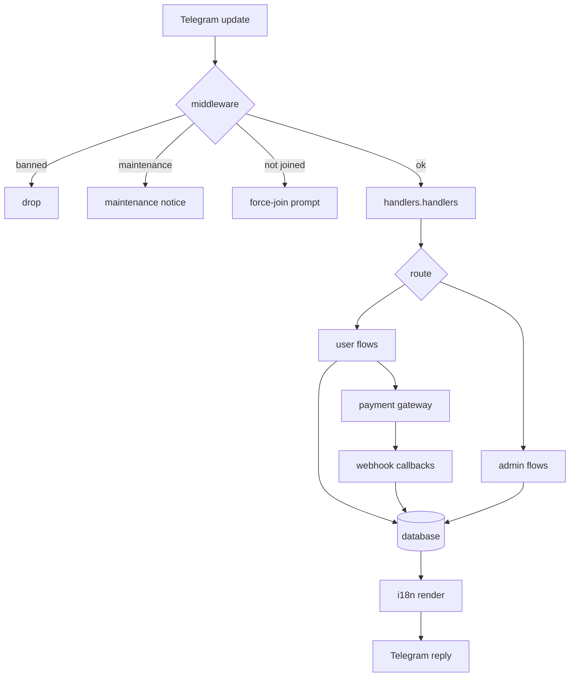

<div align="center">


# GamajBot — Project Structure

[](./STRUCTURE.md)
[](./STRUCTURE.fa.md)

[](./README.md)
[](./README.fa.md)
[](./Docs/en/architecture.md)
[](./Docs/en/usage.md)
[](./Docs/en/API.md)
[](./Docs/en/setup.md)

</div>

---

## 📁 Directory tree

```text
GamajBot/
├── cmd/
│   └── AsliCode/
│       └── main.go                  # entrypoint: load config, build bot, run
├── internal/
│   ├── bot/                         # bot assembly, polling, webhook startup, jobs
│   │   └── bot.go
│   ├── config/                      # .env loading and typed configuration
│   │   └── config.go
│   ├── database/
│   │   ├── db.go                    # database facade / interfaces
│   │   └── sqlite/                  # SQLite implementation
│   │       ├── db.go                # connection, pooling, pragmas
│   │       ├── schema.sql           # full table schema
│   │       ├── migrate.go           # schema migrations
│   │       ├── users.go             # user records
│   │       ├── admin.go             # admin queries
│   │       ├── admins.go            # admin management
│   │       ├── departments.go       # support departments
│   │       ├── tickets.go           # support tickets
│   │       ├── transactions.go      # wallet transactions
│   │       ├── manual_charge.go     # manual charge requests
│   │       ├── products.go          # products and categories
│   │       ├── category_extra.go    # category fields / extras
│   │       ├── orders.go            # order records
│   │       ├── order_actions.go     # order lifecycle actions
│   │       ├── subscription.go      # subscriptions
│   │       ├── payment_gateways.go  # gateway settings
│   │       ├── currency.go          # currency helpers
│   │       ├── analytics.go         # aggregate analytics
│   │       ├── reports.go           # reporting queries
│   │       ├── settings.go          # key/value settings
│   │       ├── log_topics.go        # admin log topics
│   │       └── xui.go               # 3x-ui panel persistence
│   ├── handlers/                    # Telegram update handlers
│   │   ├── handlers.go              # registration & routing
│   │   ├── wallet.go                # balance, history, top-up
│   │   ├── wallet_manual_card.go    # manual card receipt flow
│   │   ├── products.go              # product browsing & purchase
│   │   ├── services.go              # service management
│   │   ├── subscription.go          # subscription view / renewal
│   │   ├── language.go              # language switching
│   │   ├── forcejoin.go             # force-join prompt
│   │   ├── admin/                   # admin panel
│   │   │   ├── panel.go             # main panel & navigation
│   │   │   ├── users.go, admins.go  # user and admin management
│   │   │   ├── ban.go, deduct.go    # moderation & balance deduction
│   │   │   ├── broadcast.go         # broadcast to all users
│   │   │   ├── departments.go       # department management
│   │   │   ├── tickets.go           # ticket inbox & replies
│   │   │   ├── transactions.go      # transaction browser
│   │   │   ├── finance.go           # finance views
│   │   │   ├── manual_charge.go     # approve / reject receipts
│   │   │   ├── gateways.go          # gateway toggles and keys
│   │   │   ├── product/category*    # product & category editors
│   │   │   ├── orders.go, expiry.go # order and expiry management
│   │   │   ├── reports.go, stats.go, analytics.go
│   │   │   ├── settings.go          # runtime settings
│   │   │   ├── log_setup.go, log_actions.go
│   │   │   └── xui.go               # 3x-ui panel management
│   │   ├── support/
│   │   │   └── tickets.go           # user-side ticket flow
│   │   └── notify/
│   │       └── notify.go            # user-facing notifications
│   ├── i18n/
│   │   └── i18n.go                  # Persian/English translation maps
│   ├── isenv/
│   │   └── isenv.go                 # environment helpers
│   ├── jobs/
│   │   ├── backup.go                # scheduled data backup
│   │   ├── sync.go                  # periodic sync
│   │   ├── traffic.go               # traffic monitoring
│   │   └── daily_report.go          # daily stats report
│   ├── menus/
│   │   └── menus.go                 # keyboards and menu builders
│   ├── middleware/
│   │   ├── forcejoin.go             # membership gate
│   │   ├── maintenance.go           # maintenance gate
│   │   └── ban.go                   # banned-user gate
│   ├── notify/
│   │   ├── admin_actions.go         # admin action feed
│   │   └── admin_log.go             # admin audit log
│   ├── payment/
│   │   ├── gateway.go               # gateway interface
│   │   ├── tetraminator.go          # Tetraminator integration
│   │   ├── cubepay.go               # CubePay integration
│   │   ├── cubepay_manager.go       # CubePay session manager
│   │   └── abangateway.go           # AbanGateway integration
│   ├── qrcode/
│   │   └── qr.go                    # QR generation for configs
│   ├── rate/
│   │   ├── dollar.go                # dollar rate fetch + cache
│   │   └── currency.go              # conversion helpers
│   ├── vpn/
│   │   └── panel.go                 # VPN panel abstraction
│   ├── xui/
│   │   ├── adapter.go               # 3x-ui adapter
│   │   ├── client.go                # HTTP client
│   │   ├── client_manage.go         # client CRUD
│   │   └── types.go                 # API types
│   ├── webhook/
│   │   └── server.go                # gateway callback HTTP server
│   └── Services/
│       └── handler.go               # auxiliary service handlers
├── data/                            # runtime data (git-ignored)
│   ├── bot.db                       # SQLite database
│   ├── wallets.json                 # legacy wallet store
│   └── backups/                     # automatic DB backups
├── Docs/
│   ├── en/                          # English guides
│   │   ├── usage.md
│   │   ├── API.md
│   │   ├── architecture.md
│   │   └── setup.md
│   └── fa/                          # Persian guides
│       ├── usage.md
│       ├── API.md
│       ├── architecture.md
│       └── setup.md
├── scripts/
│   └── check-doc-links.sh           # documentation link checker (run by CI)
├── .github/
│   └── workflows/
│       └── docs-links.yml           # CI: fails on any broken documentation link
├── website/                         # documentation site (language switcher + search)
│   ├── package.json
│   └── .vitepress/
│       ├── config.mts               # locales, nav, sidebar, local search
│       └── theme/                   # base theme + RTL support for Persian
├── نه/                              # quarantine — private, git-ignored, never released
│   ├── data/                        # live SQLite DB, wallet data, automatic backups
│   └── .idea/                       # local IDE settings
├── .env.example                     # configuration template
├── .gitignore
├── go.mod / go.sum
├── LICENSE
├── README.md                        # English README
├── README.fa.md                     # Persian README
├── CHANGELOG.md / CHANGELOG.fa.md   # release history (EN / FA)
├── CONTRIBUTING.md / CONTRIBUTING.fa.md  # contribution guide (EN / FA)
├── STRUCTURE.md                     # this file
└── STRUCTURE.fa.md                  # Persian version of this file
```

---

## 🗂️ Module reference

| Package | Responsibility | Key files |
| :--- | :--- | :--- |
| `cmd/AsliCode` | Process entrypoint — loads config, wires the bot, starts it | `main.go` |
| `internal/bot` | Construction of the bot, polling loop, webhook startup, job kickoff | `bot.go` |
| `internal/config` | Reads `.env`, validates mandatory values, exposes a typed config | `config.go` |
| `internal/database` | Storage facade and the SQLite implementation (users, wallets, orders, tickets, settings) | `db.go`, `sqlite/*` |
| `internal/handlers` | All Telegram update handling, split between user and admin flows | `handlers.go`, `admin/*`, `support/*` |
| `internal/i18n` | Translation maps and the `T()` lookup used by every message | `i18n.go` |
| `internal/jobs` | Background goroutines: backup, sync, traffic, daily report | `backup.go`, `daily_report.go` |
| `internal/menus` | Reply/inline keyboards and menu builders | `menus.go` |
| `internal/middleware` | Gates applied before handlers: force join, maintenance, ban | `forcejoin.go` |
| `internal/notify` | Admin action feed and audit logging | `admin_actions.go`, `admin_log.go` |
| `internal/payment` | Gateway interface plus Tetraminator, CubePay and AbanGateway drivers | `gateway.go` |
| `internal/rate` | Dollar rate fetching, caching and Toman conversion | `dollar.go`, `currency.go` |
| `internal/xui` | 3x-ui panel client for VPN provisioning | `client.go`, `adapter.go` |
| `internal/vpn` | Panel abstraction used by product delivery | `panel.go` |
| `internal/qrcode` | QR image generation for subscription links | `qr.go` |
| `internal/webhook` | HTTP server receiving gateway callbacks | `server.go` |
| `internal/isenv` | Environment helpers | `isenv.go` |
| `scripts/` | Developer tooling — documentation link checker used by CI | `check-doc-links.sh` |
| `.github/workflows` | CI pipelines | `docs-links.yml` |
| `website/` | VitePress documentation site, bilingual with offline search | `package.json`, `.vitepress/config.mts` |
| `نه/` | Quarantine: runtime data and IDE files that must never be released (git-ignored) | `data/`, `.idea/` |

---

## 🔄 Request lifecycle



---

## 🗄️ Data layer

- **Schema** lives in `internal/database/sqlite/schema.sql`; `migrate.go` applies it on startup.
- **SQLite file** is `data/bot.db`; WAL mode is enabled (`bot.db-wal`, `bot.db-shm`).
- **Backups** are written by `internal/jobs/backup.go` to `data/backups/bot_YYYYMMDD_HHMMSS.db`.
- **Legacy JSON wallet** (`data/wallets.json`) is still read/written by the wallet helpers.

Core tables: `users`, `admins`, `departments`, `tickets`, `transactions`, `manual_charges`, `products`, `categories`, `orders`, `subscriptions`, `payment_gateways`, `settings`, `admin_logs`.

---

## 🧩 Adding code

| Goal | Where |
| :--- | :--- |
| New user command | `internal/handlers/` + register in `handlers.go` |
| New admin screen | `internal/handlers/admin/` + add to `panel.go` |
| New message text | `internal/i18n/i18n.go` (both `fa` and `en`) |
| New table/query | `internal/database/sqlite/` + update `schema.sql` and `migrate.go` |
| New payment gateway | `internal/payment/` implementing `gateway.go` |
| New scheduled task | `internal/jobs/` + start it in `internal/bot/bot.go` |

---

## 🔗 Related documents

- [README.md](./README.md) — project overview (English)
- [README.fa.md](./README.fa.md) — معرفی پروژه (فارسی)
- [Docs/en/architecture.md](./Docs/en/architecture.md) — architecture and data flow
- [Docs/en/setup.md](./Docs/en/setup.md) — installation and deployment
- [Docs/en/usage.md](./Docs/en/usage.md) — user and admin guide
- [Docs/en/API.md](./Docs/en/API.md) — API reference
- [CHANGELOG.md](./CHANGELOG.md) — release history · [تغییرات](./CHANGELOG.fa.md)
- [CONTRIBUTING.md](./CONTRIBUTING.md) — how to contribute · [راهنمای مشارکت](./CONTRIBUTING.fa.md)

<div align="center">

**Coded by AsliCode**

[](./STRUCTURE.md)
[](./STRUCTURE.fa.md)

</div>
